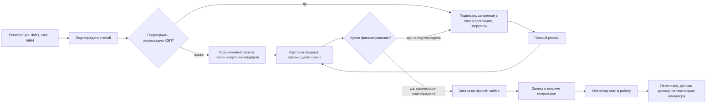

# PRD: платформа аналитики госзакупок с витриной финансирования

| | |
|---|---|
| **Продукт** | B2B-платформа: аналитика тендеров 44-ФЗ, 223-ФЗ, 615-ПП и витрина заявок на финансирование участия |
| **Документ** | Product Requirements Document, MVP |
| **Версия** | 1.0, объём MVP |
| **Владелец** | продакт-менеджер (автор) |
| **Участники** | разработчик (бэкенд и фронтенд), юрист по 152-ФЗ и финансовому регулированию, внешний аудитор безопасности кода |

## 1. Проблема

Малый бизнес, который участвует в госзакупках, упирается в деньги раньше, чем в конкуренцию:

- для заявки и исполнения контракта нужно обеспечение, а оплата по контракту приходит после исполнения и приёмки, поэтому оборотные средства замораживаются на месяцы;
- банки неохотно кредитуют малый бизнес под конкретный контракт, а инвестиционные платформы (краудлендинг) ищут заёмщиков сами и не видят тендерную историю компании;
- данные о закупках открыты в ЕИС, но разрозненны: оценить, по силам ли тендер и сколько денег он потребует, участник считает вручную.

С другой стороны, операторы инвестиционных платформ ищут проверяемых заёмщиков с понятным источником возврата. Контракт с государственным заказчиком такой источник и даёт.

## 2. Пользователи и задачи (JTBD)

| Сегмент | Работа, которую нужно сделать | Сейчас делают |
|---|---|---|
| **Участник закупок** (ИП, ООО до 100 человек, поставщики и подрядчики) | «Когда вижу подходящий тендер, хочу сразу понять, сколько денег он потребует и где их взять, чтобы не упустить контракт из-за нехватки оборотки» | смотрят ЕИС и платные агрегаторы тендеров, финансирование ищут отдельно через банк или знакомых |
| **Оператор инвестиционной платформы** (из реестра Банка России) | «Хочу получать заявки от заёмщиков с подтверждённым контрактом и понятной суммой и сроком, чтобы меньше тратить на привлечение и скоринг» | платный трафик, партнёрства с банками, ручной поиск |
| **Администратор платформы** | «Хочу обновлять политики и согласия без релиза, чтобы платформа всегда соответствовала требованиям» | правки в коде |

## 3. Ценностное предложение

- **Участнику:** в карточке тендера сразу видно, сколько денег он потребует и на какой срок, и можно в два клика разместить заявку на просчёт займа, которую увидят все подключённые операторы.
- **Оператору:** поток заявок с ИНН заёмщика, суммой, сроком и привязкой к конкретному контракту, с фильтрами по сумме и сроку.

## 4. Позиционирование и ограничения

Эти ограничения определяют архитектуру MVP и не обсуждаются в рамках приоритизации.

| Ограничение | Что это значит для продукта |
|---|---|
| Платформа не финансовый посредник | платформа справочная: показывает данные и передаёт заявку оператору. Не принимает и не перечисляет деньги, не заключает договоры займа, не оценивает кредитоспособность от своего имени. Договор займа заключается на платформе оператора |
| Операторы только из реестра Банка России | при регистрации оператор проверяется по реестру операторов инвестиционных платформ; без подтверждения кабинет оператора не открывается |
| Минимум персональных данных (152-ФЗ) | при регистрации собираются только ФИО, email и ИНН. Телефон и другие поля не запрашиваются |
| Подтверждение организации без хранения подписи | подпись пользователя не хранится на платформе и не передаётся ей; сторонние плагины ЭЦП на сайте не размещаются |
| Документы обновляет администратор | тексты политики обработки ПДн и согласий хранятся в хранилище документов и меняются без перевыкладки сайта, с версией и датой |

## 5. Объём MVP

### Входит

| # | Функция | Пользователь | Приоритет |
|---|---|---|---|
| F-1 | Регистрация по ФИО, email, ИНН, подтверждение email | все | Must |
| F-2 | Подтверждение организации: пользователь скачивает файл заявления, подписывает его КЭП в своей программе (например, Контур.Крипто), загружает подписанный файл; платформа проверяет подпись и соответствие ИНН | участник | Must |
| F-3 | Один подписант на организацию, приглашение сотрудников по email | участник | Should |
| F-4 | Поиск и фильтры тендеров: регион, ОКПД2, НМЦК, сроки, закон | участник | Must |
| F-5 | Карточка тендера с расчётом потребности в деньгах: обеспечение заявки, обеспечение исполнения, оборотные средства до оплаты, срок | участник | Must |
| F-6 | Заявка на просчёт займа из карточки тендера: сумма, срок, комментарий | участник | Must |
| F-7 | Кабинет оператора: регистрация с проверкой по реестру Банка России | оператор | Must |
| F-8 | Витрина заявок для операторов: фильтры по сумме и сроку, в заявке срок, сумма, ИНН заёмщика, расчёт рентабельности и риска по контракту | оператор | Must |
| F-9 | «Взять в работу»: заявка закрепляется за оператором, участник получает уведомление | оператор | Must |
| F-10 | Переписка заёмщика и оператора внутри платформы с дублированием на email | оба | Should |
| F-11 | Хранилище документов: политики и согласия с версиями, обновление администратором | админ | Must |
| F-12 | Подписка на аналитику: тариф, оплата, ограничение доступа к расширенным фильтрам | участник | Could |

### Не входит в MVP

- регистрация через Госуслуги (ЕСИА): подключение стоит от 2 млн руб, на этапе MVP экономически не оправдано;
- скоринг заёмщика силами платформы (риск выйти за рамки справочного сервиса);
- мобильное приложение;
- интеграция с API операторов: на MVP заявка передаётся в кабинет оператора и на почту.

## 6. Пользовательский путь

Почему заявка доступна только после подтверждения КЭП: иначе можно разместить заявку от чужого ИНН, и операторы получат мусорные лиды. Поиск тендеров открыт в ограниченном режиме, чтобы пользователь увидел ценность до того, как тратить время на подпись.

## 7. Метрики

**North Star:** число заявок на финансирование, взятых в работу операторами за месяц. Метрика растёт, только если работают обе стороны: участники создают заявки, операторы считают их качественными.

| Уровень | Метрика | Цель MVP (первые 3 месяца) | Зачем |
|---|---|---|---|
| Привлечение | регистрации участников в неделю | гипотеза: 30 | канал и позиционирование работают |
| Активация | доля зарегистрированных, открывших 3+ карточки тендеров в первую неделю | 40% | расчёт потребности в деньгах интересен |
| Подтверждение | доля активированных, подтвердивших организацию КЭП | 25% | барьер подписи не убивает воронку |
| Конверсия | доля подтверждённых, создавших заявку за 30 дней | 15% | витрина финансирования нужна |
| Качество для оператора | доля заявок, взятых в работу в течение 3 рабочих дней | 50% | заявки стоят внимания операторов |
| Сторона предложения | подключённые операторы | 3 | минимальная ликвидность витрины |
| Контроль | жалобы на нецелевое использование данных | 0 | ограничения из раздела 4 соблюдены |

Цели первых трёх месяцев сформулированы как гипотезы и пересматриваются по данным первых 4 недель.

## 8. Приоритизация (RICE)

Reach: пользователей за квартал; Impact: 0,25 / 0,5 / 1 / 2 / 3; Confidence: доля; Effort: человеко-недели.

| Функция | Reach | Impact | Confidence | Effort | RICE | Решение |
|---|---|---|---|---|---|---|
| F-5 Расчёт потребности в деньгах | 400 | 2 | 0,8 | 3 | 213 | MVP |
| F-8 Витрина заявок с фильтрами | 15 | 3 | 0,8 | 2 | 18 | MVP: без неё нет второй стороны рынка, низкий Reach обманчив |
| F-6 Заявка на просчёт займа | 120 | 3 | 0,7 | 1 | 252 | MVP |
| F-2 Подтверждение КЭП | 200 | 2 | 0,6 | 3 | 80 | MVP |
| F-10 Переписка внутри платформы | 60 | 1 | 0,7 | 2 | 21 | MVP, если укладывается в срок; иначе только email |
| F-12 Подписка на аналитику | 400 | 1 | 0,4 | 4 | 40 | после проверки, что аналитику используют (активация ≥ 40%) |
| Регистрация через ЕСИА | 400 | 0,5 | 0,9 | 12 | 15 | не в этом году |

RICE ранжирует функции одной стороны рынка; для витрины операторов решение принято вручную, и это записано в таблице.

## 9. Дорожная карта

| Этап | Срок | Содержание | Критерий перехода |
|---|---|---|---|
| MVP | 10 недель | F-1...F-9, F-11 | 3 оператора подключены, исправлены все критичные находки аудита безопасности |
| v1.1 | +6 недель | F-10, F-3, напоминания о тендерах по сохранённым фильтрам | North Star растёт 4 недели подряд |
| v1.2 | +8 недель | F-12 подписка, расширенная аналитика по заказчикам: средняя скидка, доля жалоб, сроки оплаты | конверсия в заявку ≥ 15% |
| v2 | далее | API для операторов, обогащение данных о заёмщике по открытым источникам | 10+ операторов |

## 10. Гипотезы и как их проверяем

| # | Гипотеза | Эксперимент | Успех |
|---|---|---|---|
| H-1 | Участникам важен расчёт денег под тендер, а не просто поиск тендеров | A/B: карточка с блоком расчёта и без него | +20% к доле открывших 3+ карточки |
| H-2 | Подпись КЭП в своей программе не отпугивает | воронка подтверждения, 10 интервью с отказавшимися | ≥ 25% активированных подтверждают |
| H-3 | Операторы берут заявки с привязкой к контракту охотнее обычных | интервью с 5 операторами до разработки, затем доля заявок в работе | ≥ 50% заявок в работе за 3 дня |

## 11. Риски

| Риск | Вероятность | Влияние | Что делаем |
|---|---|---|---|
| Регуляторная квалификация платформы как финансового посредника | средняя | высокое | ограничения раздела 4 заложены в архитектуру; юридическое заключение до запуска; тексты интерфейса без обещаний займа |
| Холодный старт двустороннего рынка | высокая | высокое | сначала подключаем операторов (их мало, работа вручную), затем привлекаем участников под уже работающую витрину |
| Утечка данных или уязвимость | средняя | высокое | внешний аудит кода, статический анализ безопасности (SAST), исправление критичных находок до запуска; параметризованные запросы, секреты вне кода |
| Изменения формата открытых данных ЕИС | средняя | среднее | слой загрузки отделён от витрины, мониторинг полноты загрузки |
| Заявки от чужого ИНН | низкая после F-2 | высокое | заявка только после подтверждения организации КЭП |

## 12. Открытые вопросы

1. Нужен ли оператору расчёт риска от платформы, или он считает риск сам и наш расчёт только мешает? (интервью H-3)
2. Подписка на аналитику и партнёрское вознаграждение от операторов: не создаёт ли второе конфликт интересов в глазах участника?
3. Срок хранения заявок, которые не взял ни один оператор: 90 дней или до окончания тендера?
