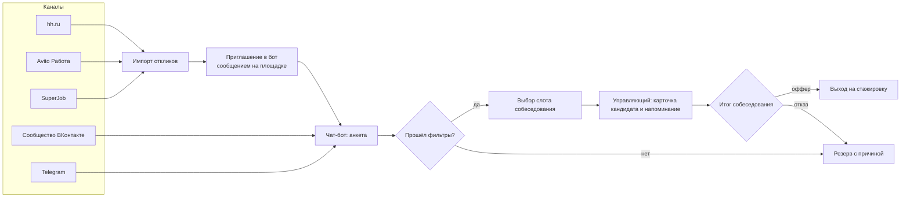
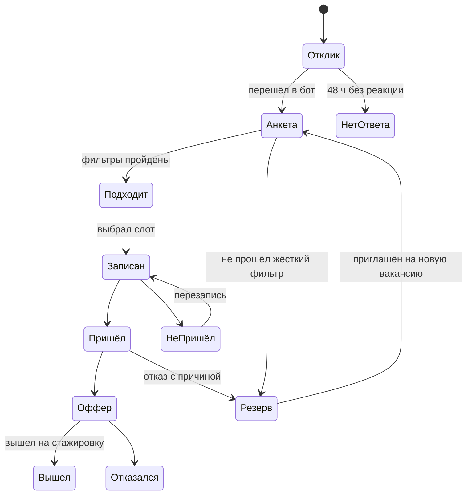

# Техническое задание: автоматизация найма линейного персонала розничной сети

| | |
|---|---|
| **Заказчик** | розничная сеть, 18 магазинов (название скрыто) |
| **Исполнитель** | команда разработки: бэкенд-разработчик, разработчик чат-бота |
| **Автор ТЗ** | менеджер проекта |
| **Версия** | 1.0 |
| **Структура** | по мотивам ГОСТ 34.602, сокращённая под небольшой проект |

## 1. Назначение и цели

Сеть постоянно нанимает продавцов-консультантов и администраторов торгового зала: текучесть на этих позициях высокая, вакансии открыты всегда. Система должна собирать отклики из всех каналов в одном месте, проводить первичный отбор без участия человека и записывать подходящих кандидатов на собеседование.

| Цель | Метрика | Сейчас | Цель через 3 месяца |
|---|---|---|---|
| Быстрее закрывать вакансии | дней от открытия вакансии до выхода сотрудника | замерить в первые 2 недели проекта | -30% к замеру |
| Не терять кандидатов | доля откликов, по которым был контакт в течение 24 часов | замерить | ≥ 90% |
| Разгрузить управляющих | часов управляющего на подбор в неделю | замерить по опросу | ≤ 2 часов |
| Снизить стоимость найма | расходы на платные размещения на одного нанятого | замерить | -20% за счёт бесплатных каналов |

## 2. Текущий процесс (AS IS)

1. Управляющий магазином или HR размещает вакансию на hh.ru, Avito Работа, SuperJob.
2. Отклики приходят в три личных кабинета и в мессенджеры; часть кандидатов звонит в магазин.
3. Управляющий в свободное время просматривает отклики, звонит, задаёт одни и те же вопросы: график, район, опыт, медкнижка, гражданство для оформления.
4. Договорённость о собеседовании фиксируется в личном календаре или нигде.
5. О статусе кандидата знает только тот, кто с ним говорил; кандидатов, которые не подошли одному магазину, никто не предлагает соседнему.

**Проблемы:** отклик ждёт ответа сутками, кандидат уходит к конкуренту; управляющие тратят время на одинаковые вопросы; нет единой базы кандидатов и статистики по каналам.

## 3. Целевой процесс (TO BE)

## 4. Роли

| Роль | Кто | Что делает в системе |
|---|---|---|
| Кандидат | соискатель | проходит анкету в чат-боте, выбирает время собеседования, получает напоминания |
| Управляющий магазином | 18 человек | видит кандидатов своего магазина, отмечает итог собеседования, открывает слоты в своём расписании |
| HR-менеджер | 1 человек | ведёт вакансии, вопросы анкеты, фильтры, видит всю воронку и отчёты |
| Администратор | ИТ | настраивает интеграции, пользователей, права |

## 5. Функциональные требования

### 5.1. Вакансии

| ID | Требование | Приоритет |
|---|---|---|
| FR-01 | HR создаёт вакансию: должность, магазины, график, ставка, требования; вакансия связывается с объявлениями на площадках по их идентификаторам | Must |
| FR-02 | У вакансии свой набор вопросов анкеты и фильтров (раздел 5.3) | Must |
| FR-03 | Вакансию можно приостановить: бот перестаёт записывать на собеседования и предлагает кандидату резерв | Should |

### 5.2. Сбор откликов

| ID | Требование | Приоритет |
|---|---|---|
| FR-04 | Отклики с hh.ru загружаются через официальное API работодателя каждые 15 минут | Must |
| FR-05 | Отклики с Avito Работа и SuperJob загружаются через их API, если доступ к откликам по API есть в тарифе заказчика; иначе HR загружает выгрузку файлом (см. открытые вопросы) | Should |
| FR-06 | На каждый новый отклик система отправляет кандидату сообщение на площадке со ссылкой на чат-бот в течение 15 минут в рабочее время (09:00-21:00) или утром следующего дня | Must |
| FR-07 | Кандидат может прийти сразу в бот: из сообщества ВКонтакте (кнопка «Работа у нас»), по QR-коду в магазине, по ссылке в Telegram | Must |
| FR-08 | Дубли: кандидат с тем же телефоном за последние 90 дней не создаётся заново, отклик добавляется в его карточку | Must |

### 5.3. Анкета и отбор в чат-боте

| ID | Требование | Приоритет |
|---|---|---|
| FR-09 | Бот работает во ВКонтакте и Telegram с одинаковым сценарием | Must |
| FR-10 | Перед вопросами бот получает согласие на обработку персональных данных со ссылкой на текст политики; без согласия анкета не продолжается | Must |
| FR-11 | Вопросы анкеты с вариантами ответа (кнопки), не больше 8 вопросов, не дольше 3 минут (приложение А) | Must |
| FR-12 | Жёсткие фильтры (например, готовность работать по графику 2/2) отсекают кандидата; мягкие (опыт в продажах) влияют только на сортировку | Must |
| FR-13 | Если кандидат не подходит выбранному магазину, но подходит другому (район, график), бот предлагает его | Should |
| FR-14 | Кандидат, бросивший анкету, получает одно напоминание через 2 часа и одно через 24 часа | Should |

### 5.4. Запись на собеседование

| ID | Требование | Приоритет |
|---|---|---|
| FR-15 | Управляющий открывает слоты собеседований в своём расписании (день, время, длительность) | Must |
| FR-16 | Кандидат, прошедший фильтры, выбирает слот в боте; слот блокируется | Must |
| FR-17 | Напоминание кандидату за 24 часа и за 2 часа с кнопками «Приду» / «Перенести» / «Отказаться» | Must |
| FR-18 | Управляющий получает уведомление о записи и сводку на день в 09:00 | Must |

### 5.5. Карточка кандидата и итоги

| ID | Требование | Приоритет |
|---|---|---|
| FR-19 | Карточка: ФИО, телефон, источник, ответы анкеты, история статусов, комментарии | Must |
| FR-20 | Статусы кандидата по воронке (приложение Б); переход между статусами только по правилам | Must |
| FR-21 | Управляющий отмечает итог собеседования в течение 24 часов, иначе напоминание; при отказе причина из списка обязательна | Must |
| FR-22 | Кандидаты в резерве доступны всем магазинам; HR может пригласить кандидата из резерва на новую вакансию | Should |

### 5.6. Отчёты

| ID | Требование | Приоритет |
|---|---|---|
| FR-23 | Воронка по вакансии, магазину и каналу: отклик, анкета начата, анкета пройдена, записан, пришёл, оффер, вышел | Must |
| FR-24 | Время на этапах: от отклика до первого контакта, до собеседования, до выхода | Must |
| FR-25 | Стоимость канала: расходы на размещение (вводит HR) на одного нанятого | Should |

## 6. Интеграции

| Система | Направление | Что передаётся | Способ |
|---|---|---|---|
| hh.ru | из hh | отклики, резюме откликнувшихся | официальное API работодателя (OAuth), опрос раз в 15 минут |
| hh.ru | в hh | сообщение кандидату со ссылкой на бот, смена статуса отклика | API |
| Avito Работа, SuperJob | из площадок | отклики | API площадки, если доступно в тарифе; иначе ручная загрузка файла |
| ВКонтакте | двусторонне | диалог с ботом | API сообщества, Callback API |
| Telegram | двусторонне | диалог с ботом | Bot API, webhook |
| Почта / SMS | в сторону управляющих | уведомления | SMTP; SMS через провайдера (опционально) |

**Ограничения:**
- Никакого сбора резюме парсингом страниц площадок: только официальные API и выгрузки. Это условие пользовательских соглашений площадок и защита от блокировки аккаунта работодателя.
- Сообщения в мессенджерах только кандидатам, которые сами начали диалог или откликнулись на вакансию.

## 7. Данные и персональные данные

| Требование | Деталь |
|---|---|
| Состав данных | ФИО, телефон, возраст (18+ как фильтр, без даты рождения), район проживания, ответы анкеты. Паспортные данные и фото не собираются |
| Согласие | фиксируется дата, время, канал и версия текста политики |
| Срок хранения | кандидаты без найма: 12 месяцев с последнего контакта, затем автоматическое удаление; по запросу кандидата удаление в течение 10 рабочих дней |
| Доступ | управляющий видит только кандидатов своего магазина и резерв; HR видит всех |
| Хранение | серверы в РФ |

## 8. Нефункциональные требования

| ID | Требование |
|---|---|
| NFR-01 | Ответ бота на сообщение кандидата не дольше 3 секунд |
| NFR-02 | Доступность бота 99% в месяц; при недоступности API площадки отклики догружаются после восстановления без потерь |
| NFR-03 | Интерфейс управляющего работает с телефона (адаптивная вёрстка от 360 px) |
| NFR-04 | Журнал действий пользователей с карточками кандидатов хранится 1 год |
| NFR-05 | Тексты бота редактирует HR без участия разработчика |

## 9. Этапы и сроки

| Этап | Содержание | Срок | Результат |
|---|---|---|---|
| 0. Обследование | замер текущих метрик, доступ к API площадок, тексты анкеты, согласование с юристом | 2 недели | подтверждённый объём, базовые значения метрик |
| 1. MVP | FR-01...FR-12, FR-15...FR-21, интеграция hh.ru, бот в Telegram и ВКонтакте | 5 недель | пилот на 3 магазинах |
| 2. Пилот | работа на 3 магазинах, исправления, доработка вопросов анкеты | 3 недели | решение о тиражировании |
| 3. Тиражирование | все 18 магазинов, Avito и SuperJob, FR-13, FR-14, FR-22...FR-25 | 3 недели | система в работе во всей сети |

## 10. Порядок приёмки

Приёмка по этапам. Этап принят, если выполнены все Must-требования этапа и критерии ниже.

| # | Критерий | Как проверяем |
|---|---|---|
| 1 | Отклик с hh.ru появляется в системе не позже 15 минут, кандидат получает ссылку на бот | тестовый отклик на тестовую вакансию |
| 2 | Анкета проходит за 3 минуты и меньше | 5 сотрудников вне проекта проходят анкету с секундомером |
| 3 | Кандидат без согласия на обработку ПДн не может продолжить анкету | тест-кейс |
| 4 | Два кандидата не могут занять один слот | одновременная запись с двух устройств |
| 5 | Повторный отклик с тем же телефоном не создаёт дубль | тест-кейс |
| 6 | Воронка в отчёте сходится с карточками кандидатов | сверка на данных пилота |
| 7 | На пилоте ≥ 90% откликов получили контакт в течение 24 часов | отчёт FR-24 за 3 недели пилота |

## 11. Допущения, ограничения, открытые вопросы

**Допущения:** у сети есть аккаунт работодателя на hh.ru с доступом к API; HR готов вести вопросы анкеты и шаблоны сообщений.

**Открытые вопросы (закрываем на этапе 0):**

1. Доступен ли приём откликов по API у Avito Работа и SuperJob в текущих тарифах сети, или нужна ручная выгрузка?
2. Какие фильтры жёсткие, а какие мягкие: решают HR и операционный директор.
3. Нужна ли передача данных нанятого сотрудника в кадровую систему (1С:ЗУП) или это отдельный проект?

---

## Приложение А. Анкета (продавец-консультант)

| # | Вопрос | Варианты | Тип |
|---|---|---|---|
| 1 | Вам есть 18 лет? | да / нет | жёсткий фильтр |
| 2 | Какой график подходит? | 2/2 / 5/2 / только выходные | жёсткий: должен совпасть с вакансией |
| 3 | В каком районе удобно работать? | список районов магазинов | подбор магазина |
| 4 | Опыт в продажах? | нет / до года / больше года | мягкий |
| 5 | Есть медицинская книжка? | да / нет, готов(а) оформить / нет | мягкий: оформление за счёт сети |
| 6 | Когда готовы выйти? | сразу / через 2 недели / позже | мягкий |
| 7 | Ваше имя и телефон | ввод | контакт |

## Приложение Б. Статусы кандидата

