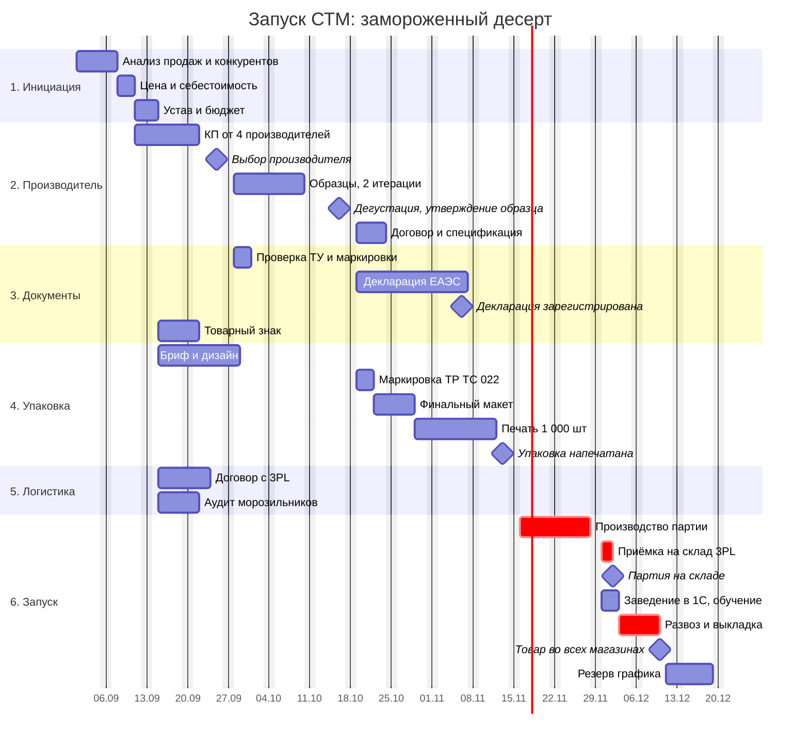

# Иерархическая структура работ и план-график

## WBS

| Код | Пакет работ | Результат | Длит., дн | Предшеств. | Ответственный |
|---|---|---|---|---|---|
| **1** | **Инициация** | | | | |
| 1.1 | Анализ продаж категории и импортного аналога | отчёт: продажи, дефицит, маржа | 5 | | категорийный менеджер |
| 1.2 | Мониторинг конкурентов: цены, вес, вкусы | таблица 6+ конкурентов | 5 | | категорийный менеджер |
| 1.3 | Целевая цена полки и себестоимость | расчёт юнит-экономики | 3 | 1.1, 1.2 | руководитель проекта |
| 1.4 | Устав, утверждение бюджета | подписанный устав | 2 | 1.3 | руководитель проекта |
| **2** | **Производитель и продукт** | | | | |
| 2.1 | Запрос КП у 4 производителей | КП с ценой, минимальной партией, сроками | 7 | 1.3 | менеджер по закупкам |
| 2.2 | Сравнение и выбор производителя | протокол выбора (М1) | 3 | 2.1 | руководитель проекта |
| 2.3 | Образцы, 2 итерации рецептуры | образцы | 10 | 2.2 | менеджер по закупкам |
| 2.4 | Дегустация, утверждение образца | протокол дегустации (М2) | 3 | 2.3 | категорийный менеджер |
| 2.5 | Договор поставки и спецификация | подписанный договор | 5 | 2.4 | менеджер по закупкам |
| **3** | **Документы и соответствие** | | | | |
| 3.1 | Проверка ТУ производителя на наш продукт | заключение юриста | 3 | 2.2 | юрист |
| 3.2 | Декларация соответствия ЕАЭС | декларация в реестре (М3) | 15 | 2.4, 3.1 | юрист |
| 3.3 | Проверка обязательной маркировки для товарной группы | заключение: нужна или нет | 2 | 2.2 | юрист |
| 3.4 | Проверка товарного знака по базе Роспатента | заключение, решение о регистрации | 5 | 1.4 | юрист |
| **4** | **Упаковка** | | | | |
| 4.1 | Бриф и дизайн упаковки | 2 концепции | 10 | 1.4 | дизайнер |
| 4.2 | Текст маркировки по ТР ТС 022/2011 | проверенный текст этикетки | 3 | 2.4, 3.1 | юрист |
| 4.3 | Финальный макет, согласование с производителем | утверждённый макет | 5 | 4.1, 4.2 | категорийный менеджер |
| 4.4 | Печать в типографии, 1 000 шт | упаковка у производителя (М4) | 10 | 4.3 | менеджер по закупкам |
| **5** | **Логистика** | | | | |
| 5.1 | Договор с 3PL на хранение при минус 18 °C | договор, тарифы | 7 | 1.4 | логист |
| 5.2 | Аудит морозильников в 18 магазинах | список: место на полке, температура | 5 | 1.4 | операционный директор |
| **6** | **Производство и запуск** | | | | |
| 6.1 | Производство первой партии | 1 000 шт | 10 | 2.5, 3.2, 4.4 | менеджер по закупкам |
| 6.2 | Приёмка на складе 3PL | акт приёмки с термограммой (М5) | 2 | 6.1, 5.1 | логист |
| 6.3 | Заведение в 1С: карточка, ШК, РРЦ | товар в 1С | 2 | 2.5 | категорийный менеджер |
| 6.4 | Обучение продавцов, материалы для выкладки | памятка, ценники | 3 | 4.3 | операционный директор |
| 6.5 | Развоз по магазинам и выкладка | фотоотчёт 18 магазинов (М6) | 5 | 6.2, 6.3, 5.2 | логист |
| **7** | **После запуска** | | | | |
| 7.1 | Еженедельный отчёт о продажах и наличии | 8 отчётов | 56 | 6.5 | категорийный менеджер |
| 7.2 | Итоги проекта, решение о второй партии | отчёт и решение (М7) | 3 | 7.1 | руководитель проекта |

## План-график

**Критический путь:** выбор производителя -> образцы -> утверждение -> декларация ЕАЭС -> производство -> приёмка -> развоз. Упаковка идёт параллельно, но её печать (4.4) заканчивается за 2 рабочих дня до старта производства: это главный риск графика (см. [04-risks.md](04-risks.md), R-03).

Плановые даты раньше директивных из устава: М5 02.12 против 04.12, М6 10.12 против 18.12: заложено 6 рабочих дней резерва на задержку декларации или печати.
